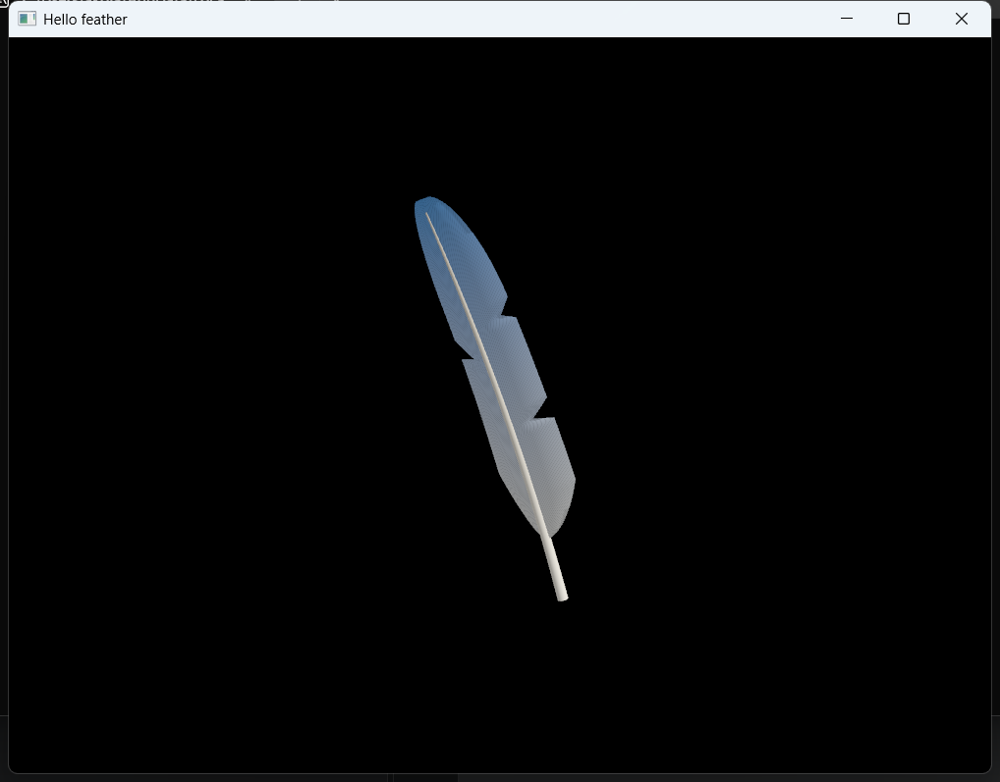

# Tutorial: your first feather app, on Windows and Android

This tutorial builds a small app on the feather.rs engine, step by step: a feather that turns
slowly in the air. At the end it runs in a window on Windows and full screen on an Android
phone, from the same Rust code.



The app is a project of its own, outside the feather.rs repository: it gets the engine from
GitHub through Cargo, as any app of yours would. It is a handful of Rust, GLSL and JSON files,
a 3D model of the feather, and a small Gradle project for Android.

> Every step was done and checked on Windows 11 (ARM64), in November 2026, with feather.rs at
> commit `366323b`, from an empty directory to the app running on Windows and on an Android
> phone.

## Contents

1. [Before you start](#1-before-you-start)
2. [Create the project](#2-create-the-project)
3. [Cargo.toml](#3-cargotoml)
4. [The feather model](#4-the-feather-model)
5. [The shaders](#5-the-shaders)
6. [The scene file](#6-the-scene-file)
7. [build.rs: building the assets](#7-buildrs-building-the-assets)
8. [The app](#8-the-app)
9. [Running on Windows](#9-running-on-windows)
10. [The Android entry point](#10-the-android-entry-point)
11. [The Android project](#11-the-android-project)
12. [Running on Android](#12-running-on-android)
13. [Where to go from here](#13-where-to-go-from-here)

## 1. Before you start

For Windows you need:

- **Rust**, stable, 1.85 or newer (edition 2024): <https://rustup.rs>.
- **The Vulkan SDK**: <https://vulkan.lunarg.com>. The build compiles shaders with its `glslc`,
  and debug builds need its validation layer (`VK_LAYER_KHRONOS_validation`).
- A GPU and driver with Vulkan.
- **Git**: Cargo fetches feather.rs from GitHub.

Check:

```powershell
cargo --version
glslc --version
```

For Android you also need Android Studio (for the SDK, the NDK and its JDK), the
`aarch64-linux-android` Rust target, `cargo-ndk`, and a phone with USB debugging on. Each of
these is installed once per machine, as described in [../android.md, Setup](../android.md#setup):
*Android SDK*, *Android NDK*, *JDK* (`JAVA_HOME`), *Rust target and `cargo-ndk`* and *The
device*. You can skip it for now and do it before step 10.

## 2. Create the project

```powershell
cargo new hello-feather
cd hello-feather
```

Every path below is relative to this `hello-feather` directory. When it's done, the project looks
like this:

```
hello-feather/
  Cargo.toml                     the package: dependencies, the library
  build.rs                       builds the assets
  resources/feather_vane.obj     the feather's model (two meshes), converted by build.rs
  resources/feather_shaft.obj
  resources/feather_scene.json   the scene: meshes, shader, materials, camera, nodes
  shaders/feather.vert           the shaders (GLSL), compiled to SPIR-V by build.rs
  shaders/feather.frag
  src/lib.rs                     the app
  src/main.rs                    Windows: opens the window and runs the app
  src/android.rs                 Android: the same, started by Android
  android/                       the Android project (Gradle), which makes the APK
```

## 3. Cargo.toml

Replace `Cargo.toml` with:

```toml
[package]
name = "hello-feather"
version = "0.1.0"
edition = "2024"

# The app's code is a library: Android loads it as a shared library (libhello_feather_app.so),
# and the Windows executable (src/main.rs) uses it too. Named apart from the executable, whose
# debug files would otherwise clash with the library's on Windows.
[lib]
name = "hello_feather_app"
crate-type = ["rlib", "cdylib"]

[dependencies]
feather = { git = "https://github.com/kashikume/feather.rs" }
anyhow = "1"
cgmath = "0.18"
log = "0.4"
winit = { version = "0.30", features = ["android-game-activity"] }

[build-dependencies]
feather-build = { git = "https://github.com/kashikume/feather.rs" }

[target.'cfg(windows)'.dependencies]
pretty_env_logger = "0.5"

[target.'cfg(target_os = "android")'.dependencies]
android_logger = "0.15"
```

- **`edition = "2024"`** is what `cargo new` writes with current Rust; the code in this tutorial
  is written for it.
- **`feather`** is the engine, **`feather-build`** the helpers `build.rs` uses (step 7). Both
  come from the feather.rs repository. The first build records the commit in `Cargo.lock`, and
  later builds stay on it (see [Updating the engine](#updating-the-engine)). To choose a commit
  yourself, add `rev = "<commit>"` to both.
- **The library and the executable.** On Android there is no `main`: the system loads the app as
  a shared library and calls a function in it (step 10). So the app's code is a library,
  `hello_feather_app`: `cdylib` makes the shared library for Android, and `rlib` lets the
  Windows executable, `src/main.rs`, use it.
- **winit**, the window and event library, must be the version feather uses (0.30).
  `android-game-activity` makes it work on Android with GameActivity, the Android class the
  app's activity will be (step 11); it does nothing on Windows.
- **cgmath** is the math library behind `feather::math` (`Mat4` and the others).
- **Logging**: `log` is what the engine and the app log through. `pretty_env_logger` prints it
  to the console on Windows; `android_logger` sends it to Android's log.

## 4. The feather model

The feather is a 3D model in two parts, each a Wavefront OBJ file: the **vane** (the flat part,
with a face on each side, since the engine doesn't draw the back of faces) and the **shaft** (a
thin tube along the middle). Download both into `resources/`:

```powershell
New-Item -ItemType Directory -Force resources | Out-Null
$src = "https://raw.githubusercontent.com/kashikume/feather.rs/main/doc/tutorial"
foreach ($f in "feather_vane.obj", "feather_shaft.obj") {
    Invoke-WebRequest "$src/$f" -OutFile "resources/$f"
}
```

They were made by feather.rs's
[tools/scripts/make_feather_obj.py](../../tools/scripts/make_feather_obj.py), which you can also
run yourself to change the feather's shape: from a clone of feather.rs,
`python tools/scripts/make_feather_obj.py <your project>/resources`. Any OBJ from a 3D program
works the same way.

The model uses the engine's axes as they are: the feather stands along Z (up), about 2.4 long,
centered on the origin. Its texture coordinates are used for colour: v goes from 0 at the base
to 1 at the tip, and u across the vane, 0.5 on the shaft.

## 5. The shaders

The engine draws with shaders you write in GLSL; `build.rs` compiles them to SPIR-V (step 7).

`shaders/feather.vert`:

```glsl
#version 450

// The camera's matrices, set by the engine for the whole scene.
layout(binding = 0) uniform Camera {
    mat4 view;
    mat4 proj;
} camera;

// The node's transform, set by the engine for each node drawn.
layout(push_constant) uniform PushConstants {
    mat4 model;
} pcs;

// The engine's vertex layout: position, normal, texture coordinates.
layout(location = 0) in vec3 inPosition;
layout(location = 1) in vec3 inNormal;
layout(location = 2) in vec2 inTexCoord;

layout(location = 0) out vec3 fragNormal;
layout(location = 1) out vec2 fragTexCoord;

void main() {
    gl_Position = camera.proj * camera.view * pcs.model * vec4(inPosition, 1.0);
    // The feather is only rotated, so the model matrix turns its normals too.
    fragNormal = mat3(pcs.model) * inNormal;
    fragTexCoord = inTexCoord;
}
```

`shaders/feather.frag`:

```glsl
#version 450

// From the material: the colours at the feather's base and at its tip, and whether to draw
// barbs (1 for the vane, 0 for the shaft).
layout(binding = 1) uniform Material {
    vec3 baseColor;
    vec3 tipColor;
    float barbs;
} material;

layout(location = 0) in vec3 fragNormal;
// u: across the vane (0.5 on the shaft); v: along the feather (0 at the base, 1 at the tip).
layout(location = 1) in vec2 fragTexCoord;

layout(location = 0) out vec4 outColor;

// The direction towards the light.
const vec3 LIGHT = normalize(vec3(1.0, -1.0, 1.5));

void main() {
    vec2 uv = fragTexCoord;
    vec3 color = mix(material.baseColor, material.tipColor, uv.y);

    // Barbs: thin lines from the shaft to the edge, slanting towards the tip.
    float along = uv.y - 0.15 * abs(uv.x - 0.5);
    float line = abs(fract(along * 140.0) - 0.5) * 2.0;
    color *= 1.0 - material.barbs * 0.18 * smoothstep(0.5, 1.0, line);

    // Lit from one side, with some light everywhere.
    float light = 0.35 + 0.65 * max(dot(normalize(fragNormal), LIGHT), 0.0);
    outColor = vec4(color * light, 1.0);
}
```

The engine fills the uniforms by name:

- `model`, `view` and `proj` with the node's transform and the camera's matrices (the scene file
  names them, next step);
- `baseColor`, `tipColor` and `barbs` from the material, so one shader draws both the vane and
  the shaft, each with its own values.

There is no texture: the colour fades from the base's to the tip's, and the vane gets fine
lines along its barbs.

## 6. The scene file

A scene holds what is drawn: meshes, shaders, materials, cameras, and a tree of nodes. It can be
built in code, but a JSON scene file is shorter. `resources/feather_scene.json`:

```json
{
  "meshes": [
    { "name": "Vane", "file": "feather_vane.fmesh" },
    { "name": "Shaft", "file": "feather_shaft.fmesh" }
  ],
  "shaders": [
    {
      "name": "Feather",
      "vertex": "feather.vert.spv",
      "fragment": "feather.frag.spv",
      "model_uniform": "model",
      "view_uniform": "view",
      "projection_uniform": "proj"
    }
  ],
  "materials": [
    {
      "name": "Vane",
      "shader": "Feather",
      "uniforms": {
        "baseColor": { "vec3": [0.95, 0.9, 0.8] },
        "tipColor": { "vec3": [0.1, 0.35, 0.75] },
        "barbs": { "float": 1.0 }
      }
    },
    {
      "name": "Shaft",
      "shader": "Feather",
      "uniforms": {
        "baseColor": { "vec3": [0.95, 0.92, 0.85] },
        "tipColor": { "vec3": [0.7, 0.65, 0.55] },
        "barbs": { "float": 0.0 }
      }
    }
  ],
  "cameras": [
    {
      "name": "Camera",
      "perspective": { "fov": 45 },
      "eye": [0, -5, 0.5],
      "target": [0, 0, 0],
      "up": [0, 0, 1],
      "near": 0.1,
      "far": 20
    }
  ],
  "root": {
    "name": "Root",
    "children": [
      {
        "name": "Feather",
        "children": [
          { "name": "Vane", "mesh": "Vane", "material": "Vane" },
          { "name": "Shaft", "mesh": "Shaft", "material": "Shaft" }
        ]
      }
    ]
  }
}
```

- **`meshes`**: the two parts of the model, by their asset names. `build.rs` (next step) makes
  `feather_vane.fmesh` from `resources/feather_vane.obj`: `.fmesh` is the engine's compact
  binary mesh format.
- **`shaders`**: the two compiled shaders, and which uniforms are the model, view and projection
  matrices.
- **`materials`**: what a node is drawn with: a shader and the values of its uniforms. A
  cream-to-blue vane with barbs, and an ivory shaft without.
- **`cameras`**: a perspective camera 5 units in front of the feather, a little above, looking
  at the origin, with Z up. The first camera is the one the scene is drawn through.
- **`root`**: the node tree. The node `Feather` holds the two parts, each drawing a mesh with a
  material. A node's transform applies to its children, so the app turns `Feather` and both
  parts follow (step 8).

Every field is described in [../scene-format.md](../scene-format.md).

## 7. build.rs: building the assets

The app reads its files (the scene, the meshes, the compiled shaders) as **assets**. `build.rs`
puts them in an `assets` directory next to the executable (`target\debug\assets\` for a debug
build): it copies the files in `resources/`, converts the OBJ meshes to `.fmesh`, and compiles
the shaders in `shaders/` with `glslc`.

`build.rs`:

```rust
//! Builds the app's assets into `assets/` next to the executable (e.g. `target/debug/assets/`):
//! the files in `resources/` are copied, except the OBJ meshes, which are converted to `.fmesh`
//! files; and the shaders in `shaders/` are compiled to SPIR-V.

use std::env;
use std::path::{Path, PathBuf};

fn main() {
    let out_dir = PathBuf::from(env::var("OUT_DIR").unwrap());
    let assets_dir = feather_build::assets_dir(&out_dir);

    feather_build::copy_dir_filtered(Path::new("resources"), &assets_dir, |path| {
        !feather_build::is_obj(path)
    });

    let meshes = feather_build::build_meshes(Path::new("resources"), &out_dir.join("meshes"));
    for mesh in meshes {
        let name = mesh.output.file_name().unwrap();
        feather_build::copy_file(&mesh.output, &assets_dir.join(name));
    }

    let shaders = feather_build::compile_shaders(Path::new("shaders"), &out_dir.join("shaders"));
    for shader in shaders {
        feather_build::copy_file(&shader.output, &assets_dir.join(&shader.relative));
    }
}
```

- `copy_dir_filtered` copies `resources/` but the OBJ files: the app loads the `.fmesh` files
  made from them instead, which are smaller and faster to load.
- `build_meshes` converts every `resources/<name>.obj` into `<name>.fmesh`; the loop copies
  them to the assets.
- `compile_shaders` compiles every shader in `shaders/`, e.g. `feather.vert` into
  `feather.vert.spv`. It finds `glslc` through the Vulkan SDK (`VULKAN_SDK`) or the `PATH`.

`feather-build` can also pack images into atlases and render fonts; see the README's
[Building](../../README.md#building) section and the test app's `build.rs`.

On Android the same `build.rs` runs on your PC and builds the same assets; step 11 puts them in
the APK.

## 8. The app

An app implements the `FeatherApp` trait: it gives the engine its scenes and is called every
frame. `src/lib.rs`:

```rust
//! A feather, turning slowly as it floats.

use anyhow::{anyhow, Result};
use cgmath::Deg;

use feather::assetsprovider::AssetsProvider;
use feather::featherapp::FeatherApp;
use feather::math::Mat4;
use feather::scene::Scene;

#[cfg(target_os = "android")]
mod android;

pub struct FeatherDemo {
    scene: Scene,
    /// The handle of the node `Feather` in the scene, which holds the vane and the shaft.
    feather: usize,
}

impl FeatherDemo {
    pub fn new(assets: &dyn AssetsProvider) -> Result<Self> {
        let scene = Scene::load(assets, "feather_scene.json")?;
        let feather = scene
            .find_node("Feather")
            .ok_or_else(|| anyhow!("the scene has no node `Feather`"))?;
        Ok(Self { scene, feather })
    }
}

impl FeatherApp for FeatherDemo {
    fn on_create(&mut self) -> Result<()> {
        Ok(())
    }

    fn on_render(&mut self) -> Result<()> {
        Ok(())
    }

    /// `time`: seconds since the app started.
    fn on_update(&mut self, time: f32) -> Result<()> {
        // Turn around the vertical axis (40° a second), rocking a little from side to side.
        let turn = Mat4::from_angle_z(Deg(40.0 * time));
        let rock = Mat4::from_angle_y(Deg(15.0 * (1.5 * time).sin()));
        self.scene
            .get_node_mut(self.feather)
            .unwrap()
            .set_transform(rock * turn);
        Ok(())
    }

    fn on_destroy(&mut self) {}

    fn get_num_scenes_to_render(&self) -> usize {
        1
    }

    fn get_scene_to_render(&mut self, _scene_index: usize) -> &mut Scene {
        &mut self.scene
    }
}
```

- **`AssetsProvider`** reads assets. It is the only thing that differs between the platforms:
  files next to the executable on Windows, the APK's assets on Android. The app takes it from
  outside (steps 9 and 10), so `FeatherDemo` itself is the same on both.
- **`Scene::load`** reads the scene file, and **`find_node`** gives the handle of a node by
  name. Nodes, meshes and the rest are kept in the scene and referred to by handles (`usize`).
- **`on_update`** is called before every frame with the time since the start. Here it sets the
  `Feather` node's transform: a turn around Z (40° a second), tilted back and forth around Y by
  up to 15°. The vane and the shaft, its children, follow.
- **`get_num_scenes_to_render`** and **`get_scene_to_render`**: the scenes drawn, in order, each
  through its camera. One here.
- `on_create`, `on_render` and `on_destroy` have nothing to do here. `FeatherApp` has more
  methods, with default bodies, for keys, the mouse (touch on Android) and window size; see the
  README's [Writing an application](../../README.md#writing-an-application).
- `mod android` is the Android entry point, written in step 10. Until then, comment the line out
  (with `//`) or create an empty `src/android.rs`: it's compiled only for Android.

## 9. Running on Windows

`src/main.rs`, replacing what `cargo new` put there:

```rust
//! The app on Windows.

use anyhow::Result;
use winit::dpi::LogicalSize;
use winit::event_loop::EventLoop;
use winit::window::Window;

use feather::app::App;
use feather::assetsprovider::create_assets_provider;

use hello_feather_app::FeatherDemo;

fn main() -> Result<()> {
    pretty_env_logger::init();

    // The assets build.rs put in `assets/` next to the executable.
    let assets = create_assets_provider("assets")?;
    let app = FeatherDemo::new(assets.as_ref())?;

    let event_loop = EventLoop::new()?;
    let window = Window::default_attributes()
        .with_title("Hello feather")
        .with_inner_size(LogicalSize::new(800, 600));
    App::run(event_loop, window, Box::new(app))
}
```

`App::run` opens the window, starts the engine (Vulkan) and runs the app until the window is
closed.

Run it:

```powershell
cargo run
```

The first build fetches feather.rs and builds every dependency, which takes a few minutes; later
ones take seconds. A window opens with the feather turning, as in the picture at the top.

To see the engine's log (the GPU it picked, the swapchain, any error), set `RUST_LOG` first:

```powershell
$env:RUST_LOG = "info"
cargo run
```

```
 INFO  feather::scenefile > 2 meshes built in 14.5 ms
 INFO  feather::physicaldevice > Selected physical device (`Qualcomm(R) Adreno(TM) X1-85 GPU`).
 ...
```

- `Validation layer requested but not supported.`: debug builds turn on Vulkan's validation
  layer, from the Vulkan SDK; install it, or build with `cargo run --release` (no validation).
- `failed to read asset ...\target\debug\assets\feather_scene.json`: the file isn't in
  `resources/`, or has another name than the one in `Scene::load`. The same for a mesh means the
  OBJ is missing from `resources/`.
- Warnings from `feather::instance` about `loader_add_layer_properties` or ICD JSON files come
  from the Vulkan loader reading other programs' drivers and layers; they are harmless.

## 10. The Android entry point

From here on you need the Android setup from step 1.

On Android, the system starts a Java activity (step 11), which loads `libhello_feather_app.so`
and calls its function `android_main`. That function does what `main` does on Windows.
`src/android.rs`:

```rust
//! The app on Android.

use log::LevelFilter;
use winit::event_loop::EventLoop;
use winit::platform::android::EventLoopBuilderExtAndroid;
use winit::window::Window;

use feather::androidassetsprovider::AndroidAssetsProvider;
use feather::app::App;
use feather::AndroidApp;

use crate::FeatherDemo;

/// Called by Android (through GameActivity) when the app starts.
#[unsafe(no_mangle)]
fn android_main(app: AndroidApp) {
    // Log to logcat, under the tag `hello-feather`.
    android_logger::init_once(
        android_logger::Config::default()
            .with_max_level(LevelFilter::Info)
            .with_tag("hello-feather"),
    );
    std::panic::set_hook(Box::new(|info| log::error!("{info}")));

    if let Err(e) = run(app) {
        log::error!("{e:#}");
    }
    // End the process: Android may otherwise call `android_main` again in it, and winit can't
    // run a second event loop in one process.
    unsafe { _exit(0) }
}

unsafe extern "C" {
    fn _exit(status: i32) -> !;
}

fn run(app: AndroidApp) -> anyhow::Result<()> {
    let event_loop = EventLoop::builder().with_android_app(app.clone()).build()?;
    let window = Window::default_attributes();
    // The assets are inside the APK.
    let assets = AndroidAssetsProvider::new(&app);
    let demo = FeatherDemo::new(&assets)?;
    App::run(event_loop, window, Box::new(demo))
}

/// Called by `MainActivity` when back is pressed: ends the engine's event loop.
#[unsafe(no_mangle)]
extern "system" fn Java_com_example_hellofeather_MainActivity_nativeRequestExit(
    _env: *mut std::ffi::c_void,
    _this: *mut std::ffi::c_void,
) {
    feather::app::request_exit();
}
```

(Put `mod android;` in `src/lib.rs` back if you commented it out.)

- **`#[unsafe(no_mangle)]`** keeps the functions' names as they are, so Android finds them.
  Edition 2024 marks it `unsafe` (two functions of the same name would clash), as it does the
  `extern` block declaring C's `_exit`.
- **The event loop is built with the `AndroidApp`**, the handle to the running activity, so winit
  gets its events. The window takes the whole screen; its title and size don't apply.
- **`AndroidAssetsProvider`** reads the assets from the APK. `FeatherDemo` is the same as on
  Windows.
- **Panics and errors** go to the log: without this, a panic shows only as a crash.
- **`_exit`** ends the process at the end, without running C++ destructors; see
  [../android.md, The app as a library](../android.md#the-app-as-a-library-and-android_main) for
  why `std::process::exit` doesn't do here.
- **`Java_com_example_hellofeather_MainActivity_nativeRequestExit`**: the activity calls this
  when back is pressed (step 11), to end the engine's loop (winit 0.30 doesn't on its own on
  Android). The name is Java's rule for native methods, `Java_<package>_<class>_<method>`, with
  the package's dots as `_`: it must match the activity's package, `com.example.hellofeather`.

Check that the library builds for Android:

```powershell
cargo ndk -t arm64-v8a build --lib
```

It ends with `Finished` and makes `target\aarch64-linux-android\debug\libhello_feather_app.so`,
with the assets next to it in `target\aarch64-linux-android\debug\assets\`. (The first build
compiles every dependency for Android again.) The Windows build is unchanged: `src/android.rs`
is compiled only for Android.

## 11. The Android project

The APK is made by Gradle from a small Android project in `android/`. It holds the activity (in
Kotlin), the manifest, and a task that runs `cargo ndk` and puts the library and the assets in
the APK.

```
android/
  settings.gradle.kts
  build.gradle.kts
  gradle.properties
  local.properties                  where the Android SDK is (per machine)
  gradlew, gradlew.bat, gradle/wrapper/   the Gradle wrapper
  app/
    build.gradle.kts
    src/main/AndroidManifest.xml
    src/main/kotlin/com/example/hellofeather/MainActivity.kt
```

**The Gradle wrapper** downloads and runs the right Gradle version. Take it from the feather.rs
repository, in PowerShell from the `hello-feather` directory:

```powershell
New-Item -ItemType Directory -Force android\gradle\wrapper | Out-Null
$src = "https://raw.githubusercontent.com/kashikume/feather.rs/main/apps/testapp/android"
foreach ($f in "gradlew", "gradlew.bat", "gradle/wrapper/gradle-wrapper.jar", "gradle/wrapper/gradle-wrapper.properties") {
    Invoke-WebRequest "$src/$f" -OutFile "android/$f"
}
```

It is Gradle 9.9.1, which runs on the JDK 25 of current Android Studio (see
[../android.md, JDK](../android.md#jdk)).

`android/settings.gradle.kts`:

```kotlin
pluginManagement {
    repositories {
        google()
        mavenCentral()
        gradlePluginPortal()
    }
}

dependencyResolutionManagement {
    repositoriesMode.set(RepositoriesMode.FAIL_ON_PROJECT_REPOS)
    repositories {
        google()
        mavenCentral()
    }
}

rootProject.name = "HelloFeather"
include(":app")
```

`android/build.gradle.kts`:

```kotlin
plugins {
    id("com.android.application") version "9.5.1" apply false
}
```

`android/gradle.properties`:

```properties
org.gradle.jvmargs=-Xmx2048m -Dfile.encoding=UTF-8
```

`android/app/build.gradle.kts`:

```kotlin
import javax.inject.Inject

plugins {
    id("com.android.application")
}

android {
    namespace = "com.example.hellofeather"
    compileSdk = 37
    ndkVersion = "30.0.16248370"

    defaultConfig {
        applicationId = "com.example.hellofeather"
        minSdk = 30
        targetSdk = 37
        versionCode = 1
        versionName = "0.1.0"

        ndk {
            abiFilters += "arm64-v8a"
        }
    }
}

dependencies {
    // Must be the GameActivity version built into the Rust side (winit 0.30).
    implementation("androidx.games:games-activity:4.4.0")
    implementation("androidx.appcompat:appcompat:1.8.0")
}

/** Builds the Rust library with `cargo ndk` and copies the assets build.rs made. */
abstract class CargoNdkTask : DefaultTask() {
    @get:Inject
    abstract val exec: ExecOperations

    @get:Inject
    abstract val files: FileSystemOperations

    /** The Rust project's directory, where `cargo` runs. */
    @get:Internal
    abstract val cargoDir: DirectoryProperty

    @get:OutputDirectory
    abstract val jniLibsDir: DirectoryProperty

    @get:OutputDirectory
    abstract val assetsDir: DirectoryProperty

    @TaskAction
    fun build() {
        val dir = cargoDir.get().asFile
        exec.exec {
            workingDir = dir
            commandLine(
                "cargo", "ndk", "-t", "arm64-v8a", "-P", "30",
                "-o", jniLibsDir.get().asFile.absolutePath,
                "build", "--lib", "--release",
            )
        }
        files.sync {
            from(dir.resolve("target/aarch64-linux-android/release/assets"))
            into(assetsDir)
        }
    }
}

androidComponents {
    onVariants { variant ->
        val name = variant.name.replaceFirstChar { it.uppercase() }
        val cargo = tasks.register<CargoNdkTask>("cargoNdk$name") {
            cargoDir.set(rootProject.layout.projectDirectory.dir(".."))
            // Cargo decides what to rebuild; Gradle runs it every time.
            outputs.upToDateWhen { false }
        }
        variant.sources.jniLibs?.addGeneratedSourceDirectory(cargo, CargoNdkTask::jniLibsDir)
        variant.sources.assets?.addGeneratedSourceDirectory(cargo, CargoNdkTask::assetsDir)
    }
}
```

- **`namespace` and `applicationId`**: the app's package, `com.example.hellofeather`. Choose
  your own for a real app (and change it in the activity and the JNI name of step 10 too).
- **`compileSdk`/`targetSdk` 37** is Android 17; **`minSdk` 30** is Android 11. Only 64-bit ARM
  (`arm64-v8a`) is built: what current phones are.
- **`ndkVersion`** must be an NDK installed in the SDK Manager. Gradle uses it to strip the
  library's debug information.
- **GameActivity 4.4.0** must match the GameActivity code compiled into the Rust side, which
  comes with winit 0.30 (see
  [../android.md, How the engine runs on Android](../android.md#how-the-engine-runs-on-android)).
- **`CargoNdkTask`** runs `cargo ndk ... build --lib --release` in the `hello-feather`
  directory, then copies the assets `build.rs` made. Its two output directories become the APK's
  libraries and assets. Rust is built optimized even for a debug APK: unoptimized Rust is slow on
  a phone, and release builds don't need the validation layers, which phones don't have.

`android/app/src/main/AndroidManifest.xml`:

```xml
<?xml version="1.0" encoding="utf-8"?>
<manifest xmlns:android="http://schemas.android.com/apk/res/android">

    <uses-feature
        android:name="android.hardware.vulkan.version"
        android:required="true"
        android:version="0x400000" />

    <application
        android:label="Hello feather"
        android:theme="@style/Theme.AppCompat.NoActionBar">

        <activity
            android:name=".MainActivity"
            android:configChanges="orientation|screenSize|screenLayout|smallestScreenSize|keyboard|keyboardHidden|navigation|density|uiMode"
            android:exported="true">

            <intent-filter>
                <action android:name="android.intent.action.MAIN" />
                <category android:name="android.intent.category.LAUNCHER" />
            </intent-filter>

            <meta-data
                android:name="android.app.lib_name"
                android:value="hello_feather_app" />
        </activity>
    </application>
</manifest>
```

- **`uses-feature` Vulkan 1.0** (`0x400000`): the engine draws with Vulkan.
- **`configChanges`**: Android doesn't recreate the activity when the phone turns or the screen
  changes; the engine only sees the window's new size. Recreating it would call `android_main`
  again, which winit can't handle in one process.
- **`android.app.lib_name`**: the library GameActivity loads, `libhello_feather_app.so` (the
  `[lib]` name of step 3).

`android/app/src/main/kotlin/com/example/hellofeather/MainActivity.kt`:

```kotlin
package com.example.hellofeather

import android.os.Bundle
import androidx.activity.OnBackPressedCallback
import com.google.androidgamesdk.GameActivity

/** Loads the Rust library named in the manifest and runs its `android_main`. */
class MainActivity : GameActivity() {
    override fun onCreate(savedInstanceState: Bundle?) {
        super.onCreate(savedInstanceState)
        // Back ends the app: the Rust side ends its event loop, then the activity finishes.
        onBackPressedDispatcher.addCallback(
            this,
            object : OnBackPressedCallback(true) {
                override fun handleOnBackPressed() {
                    nativeRequestExit()
                    finish()
                }
            },
        )
    }

    /** In the Rust library (src/android.rs). */
    private external fun nativeRequestExit()
}
```

The test app's activity also hides the status and navigation bars and keeps the screen on; see
`apps/testapp/android/app/src/main/kotlin/.../MainActivity.kt` in feather.rs.

**`local.properties`** tells Gradle where the Android SDK is. It differs per machine (keep it
out of version control). From the `android` directory:

```powershell
cd android
Set-Content local.properties "sdk.dir=$($env:LOCALAPPDATA -replace '\\','\\' -replace ':','\:')\\Android\\Sdk" -Encoding ascii
```

(Android Studio writes the same file when it opens the project.)

Finally, add Gradle's files to the `.gitignore` that `cargo new` made:

```
/android/.gradle
/android/.kotlin
/android/build
/android/app/build
/android/local.properties
```

## 12. Running on Android

Build the APK, from the `android` directory:

```powershell
.\gradlew.bat assembleDebug
```

The first build downloads Gradle, the Android Gradle plugin and the AndroidX libraries, and
builds the Rust library optimized for Android: about a minute and a half here. It ends with
`BUILD SUCCESSFUL` and makes `app\build\outputs\apk\debug\app-debug.apk` (about 11 MB). It also
prints `Deprecated Gradle features were used in this build` and `Consider enabling configuration
cache`, which need no action.

The APK holds the library and the assets:

```
lib/arm64-v8a/libhello_feather_app.so
assets/feather.frag.spv
assets/feather.vert.spv
assets/feather_scene.json
assets/feather_shaft.fmesh
assets/feather_vane.fmesh
```

With the phone connected (`adb devices` lists it as `device`; see
[../android.md, The device](../android.md#the-device)), install it and start it:

```powershell
.\gradlew.bat installDebug
adb shell am start -n com.example.hellofeather/.MainActivity
```

The feather turns, full screen. *Hello feather* is now among the phone's apps too. Back ends it.

The log, filtered to the app's tag:

```powershell
adb logcat -s hello-feather
```

Errors, such as a missing asset or a panic, show here.

## 13. Where to go from here

- **Textures, lighting, shadows, text, UI, several scenes, animation**: the README's
  [Writing an application](../../README.md#writing-an-application) and the test app's demos
  (`apps/testapp/src/testapp/demo_*.rs` in feather.rs). Demo 1 is a textured cube; demo 4 adds
  lighting with a highlight; demo 7 loads OBJ meshes like this feather.
- **The scene file format**: [../scene-format.md](../scene-format.md).
- **Meshes**: the `.fmesh` format and the mesh converter: [../fmesh-format.md](../fmesh-format.md).
- **Android in depth**: the lifecycle (what happens when the app goes to the background), touch
  input, release APKs and signing, debugging: [../android.md](../android.md).
- **Your own app's names**: the package `com.example.hellofeather` appears in
  `app/build.gradle.kts` (`namespace`, `applicationId`), in `MainActivity.kt` (its `package` line
  and its folder) and in the JNI name in `src/android.rs`; the library's name
  `hello_feather_app` in `Cargo.toml` and the manifest's `lib_name`.

### Updating the engine

The app stays on the feather.rs commit recorded in `Cargo.lock` until you update it. To move to
the newest commit on `main`, run in the project's directory (the one with `Cargo.toml`):

```powershell
cargo update -p feather
```

```
    Updating git repository `https://github.com/kashikume/feather.rs`
    Updating atlas-creator v0.1.0 (https://github.com/kashikume/feather.rs#92f47eba) -> #366323b9
    Updating feather v0.0.1 (https://github.com/kashikume/feather.rs#92f47eba) -> #366323b9
    Updating feather-build v0.0.1 (https://github.com/kashikume/feather.rs#92f47eba) -> #366323b9
    ...
```

- `feather-build` and the engine's helper crates come from the same repository, so they move
  together with `feather`.
- Then build as usual: `cargo run` on Windows; on Android `.\gradlew.bat installDebug`, which
  runs `cargo ndk` and picks up the new engine by itself.
- `cargo update` (without `-p`) also updates your other dependencies (`anyhow`, `log`, ...)
  within their version ranges.
- To go to a given commit instead: `cargo update -p feather --precise <commit>`. To stay on one
  for good, add `rev = "<commit>"` to both feather entries in `Cargo.toml` (step 3).
- If the build breaks after an update, the engine's API or what it needs may have changed: the
  winit version (step 3), or the GameActivity version in `android/app/build.gradle.kts`
  (step 11). The feather.rs history on GitHub shows what changed.
